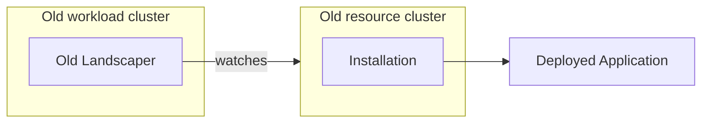
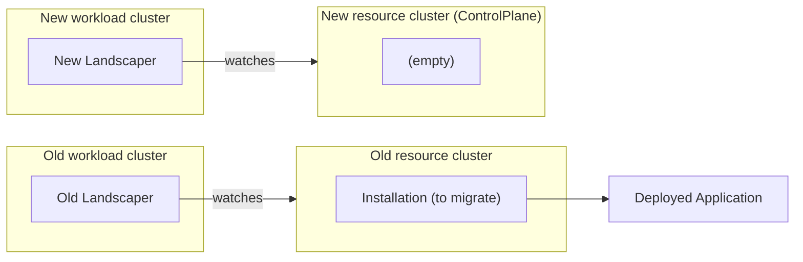
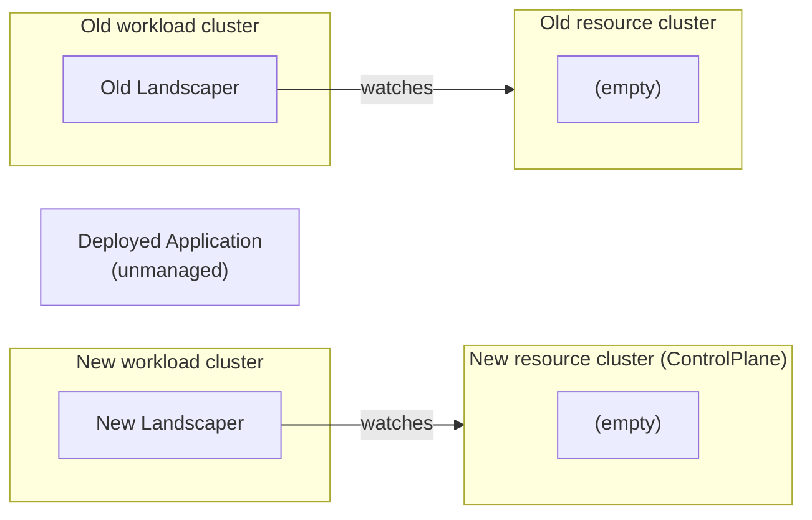
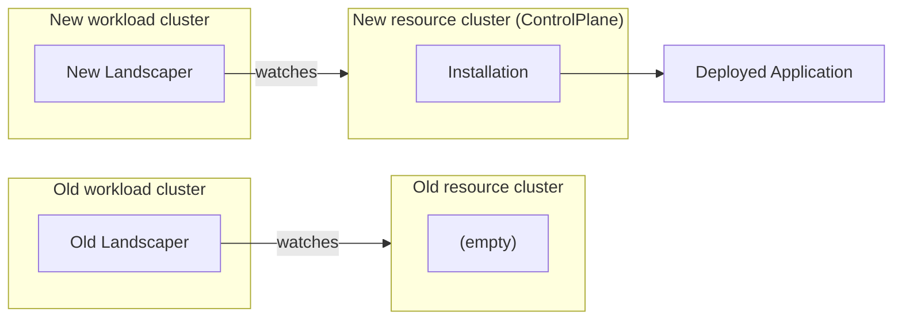

# Migration Guide: Moving Installations to a New Landscaper Instance

This guide explains how to migrate Landscaper [Installations](./Installation.md) from one Landscaper instance to another managed by OpenControlPlane. The procedure ensures that already-deployed applications are **not uninstalled and reinstalled** during the migration.


## Terminology

| Term                     | Meaning                                                                                                                                                          |
|--------------------------|------------------------------------------------------------------------------------------------------------------------------------------------------------------|
| **Old resource cluster** | The cluster where the Installations currently live and are reconciled by the old Landscaper. This may be the same cluster the old Landscaper runs on.            |
| **Old Landscaper**       | The existing Landscaper instance that currently reconciles the Installations.                                                                                    |
| **New resource cluster** | The cluster where the Installations will live after migration. Using OpenControlPlane, this is the ControlPlane cluster.                                         |
| **New Landscaper**       | The Landscaper instance that will reconcile the Installations after migration. When using OpenControlPlane, this is the Landscaper managed by OpenControlPlane.  |
| **Target cluster**       | The cluster(s) where the applications managed by the Installations are actually deployed. These clusters are **not** affected by the migration.                  |


## Prerequisites

- `kubectl` access to both the old resource cluster and the new resource cluster (ControlPlane cluster).
- A way to recreate the Installations on the new resource cluster: either from the exported backup created in step 2, or from a GitOps repository if you manage your Installations that way.


## Step-by-Step Migration

### Starting Point

Before the migration, the old Landscaper watches the old resource cluster and manages the Installations there. The deployed applications run on one or more target clusters.



The old workload cluster and the old resource cluster could be the same cluster.

### Step 1: Set Up the New Landscaper

Create a `ControlPlane` resource and a `Landscaper` resource with the same name and namespace on the onboarding cluster of your OpenControlPlane environment. 

As a result, OpenControlPlane will provision a new control plane cluster (the new resource cluster) and a Landscaper instance watching it.



### Step 2: Export the Existing Installations

Before making any changes, export the manifests of all root Installations you want to migrate from the old resource cluster:

```bash
kubectl get installations --all-namespaces -o yaml > installations-backup.yaml
```

Also export any dependent resources:

```bash
# Contexts (hold registry credentials, repository URLs, etc.)
kubectl get contexts --all-namespaces -o yaml > contexts-backup.yaml

# Targets (hold kubeconfigs or references to target clusters)
kubectl get targets --all-namespaces -o yaml > targets-backup.yaml

# DataObjects (hold import data referenced by the Installations)
kubectl get dataobjects --all-namespaces -o yaml > dataobjects-backup.yaml

# Secrets and ConfigMaps (may hold import parameters referenced by the Installations)
kubectl get secrets --all-namespaces -o yaml > secrets-backup.yaml
kubectl get configmaps --all-namespaces -o yaml > configmaps-backup.yaml
```

Review the exported files and remove any cluster-managed metadata fields (`resourceVersion`, `uid`, `creationTimestamp`, `generation`, `managedFields`, `finalizers`, `status`) before applying them to the new cluster in step 4.

### Step 3: Annotate the Root Installations for Delete-Without-Uninstall

Add the `landscaper.gardener.cloud/delete-without-uninstall: "true"` annotation to every **root** Installation you want to migrate.

This annotation tells Landscaper that when the Installation is deleted, it does not trigger an actual uninstall of the deployed applications on the target clusters.

> **Important:** The annotation must be set _before_ the deletion in step 4.

How to annotate a root Installation:

```bash
kubectl annotate installation <name> -n <namespace> landscaper.gardener.cloud/delete-without-uninstall=true
```

You can verify the annotation is present before proceeding:

```bash
kubectl get installation <name> -n <namespace> \
  -o jsonpath='{.metadata.annotations.landscaper\.gardener\.cloud/delete-without-uninstall}'
# Expected output: true
```

Repeat this for each root Installation you want to migrate.

See [Annotations — Delete-Without-Uninstall](./Annotations.md#delete-without-uninstall-annotation) for the full reference.

### Step 4: Delete the Root Installations

Delete each annotated root Installation from the old resource cluster:

```bash
kubectl delete installation <name> -n <namespace>
```

Repeat for each root Installation. 
Wait until all Installations are gone before continuing:

```bash
kubectl get installations --all-namespaces
# Should return no resources
```



### Step 5: Create Resources on the New Landscape Cluster

For the following commands use the kubeconfig for the new resource cluster (ControlPlane cluster).

On the ControlPlane cluster, create the Context, Target, DataObject, Secret, ConfigMap, and Installation resources.
Note: Create the Installations last to avoid that they fail, because a referenced object is not yet there.

The new Landscaper detects the new Installations. Because the deployed applications are already present on the target clusters and match the desired state, the Landscaper will reconcile them without making any changes to the target clusters.

> **Note:** Root Installations require the `landscaper.gardener.cloud/operation: reconcile` annotation to trigger their first reconciliation. If the Installations you exported already have this annotation, they will be picked up automatically. If not, add it after applying:
>
> ```bash
> kubectl annotate installation <name> --namespace <namespace> \
>   landscaper.gardener.cloud/operation=reconcile
> ```



### Step 6: Verify the Migration

Check that all Installations reach the `Succeeded` phase on the new resource cluster:

```bash
kubectl get installations --all-namespaces
```

All Installations should show `phase: Succeeded` (assuming they worked before the migration).


### Step 7: Clean Up the Old Environment

Once all Installations are reconciled successfully on the new resource cluster, the old environment is no longer needed.

If the old Landscaper and its clusters are not used for anything else, you can now:

- Uninstall the old Landscaper instance.
- Delete the old resource cluster.
- Delete the old workload cluster (the cluster the old Landscaper ran on).

